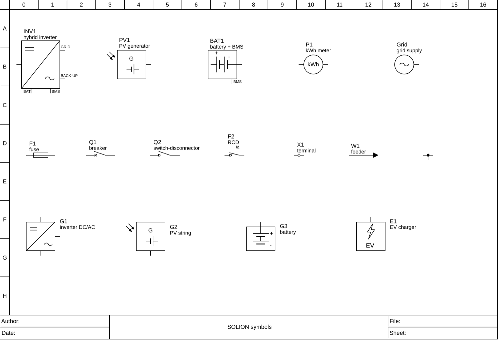

# Symbols for PV single-line diagrams (QElectroTech)

16 elements drawn for photovoltaic / battery single-line diagrams, used with QElectroTech 0.200 and qet-mcp.

| file | symbol | terminals (index order) |
|---|---|---|
| `razsmernik_hibridni.elmt` | hybrid inverter | GRID, DC, BACKUP, BAT, BMS |
| `pv_generator_h.elmt` / `pv_generator.elmt` | PV generator / string (horizontal / vertical) | DC |
| `hranilnik_baterija_h.elmt` / `hranilnik_baterija.elmt` | battery storage (with BMS / vertical) | DC, BMS |
| `razsmernik_dc_ac.elmt` | inverter DC/AC (vertical) | DC, BAT, AC |
| `stevec_kwh_h.elmt` | kWh meter | 1, 2 |
| `omrezje_vir.elmt` | grid supply | L |
| `polnilnica_ev.elmt` | EV charger | AC |
| `odvod_puscica.elmt` | outgoing feeder (arrow) | 1 |
| `razcep_t.elmt` | T junction, terminal type: all three terminals share one potential | 1, 2, 3 |
| `varovalka_h.elmt`, `odklopnik_h.elmt`, `locilnik_h.elmt`, `rcd_h.elmt`, `sponka_h.elmt` | fuse, circuit breaker, switch-disconnector, RCD, terminal, drawn horizontally (input on the left) | 1, 2 |

Every symbol carries `%{label}` and `%{comment}` fields above or beside it. Terminals are on the 10 px grid.

**Licence:** the five horizontal IEC 60617 symbols (`*_h.elmt` for the fuse, breaker, switch-disconnector, RCD and terminal) are mirrored from the
QElectroTech elements collection (© The QElectroTech Team, [CC-BY 3.0](http://creativecommons.org/licenses/by/3.0/)). The others were drawn by
David Podlesnik and are released under the same CC-BY 3.0 terms, so they can join the collection.

